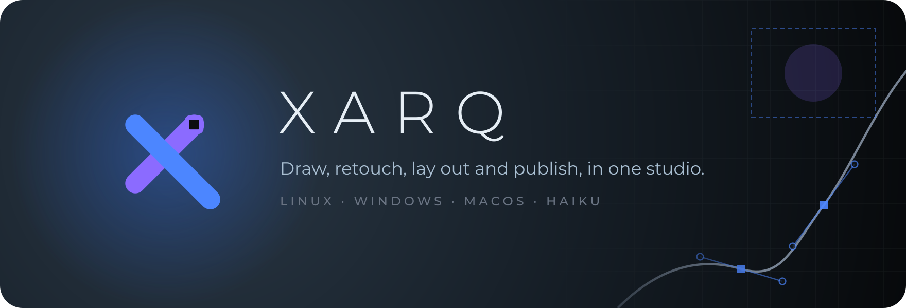
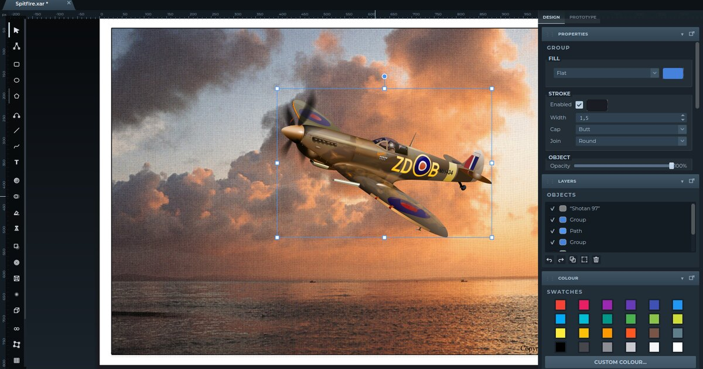

  

  <b>A free and open source vector, photo and page layout studio for Linux, Windows, macOS and Haiku.</b> 
  XarQ reads and writes native Xara <code>.xar</code> files, and opens files from many other design tools.

  <a href="https://xarq.org">Website</a> ·
  <a href="https://xarq.org/download">Download</a> ·
  <a href="https://github.com/XarQ-design/xarq">Source</a> ·
  <a href="https://github.com/XarQ-design/xarq/issues">Issues</a>

  

## The app

**[xarq](https://github.com/XarQ-design/xarq)**: the desktop app (GPL-2.0), written in C++ with Qt 6. It is an alpha:
it works, but expect rough edges.

- **Linux**: the AppImage from the [releases page](https://github.com/XarQ-design/xarq/releases/latest).
- **Windows**: the installer or the portable zip from the [releases page](https://github.com/XarQ-design/xarq/releases/latest).
- **macOS** (Apple silicon): `brew install xarq-design/xarq/xarq`, from our tap.
- **Haiku**: add our package repository, then install it like any other package:
  `pkgman add-repo https://xarq.org/haiku/x86_64/current` and `pkgman install xarq`.

## Packaging

**[homebrew-xarq](https://github.com/XarQ-design/homebrew-xarq)**: the Homebrew tap, with ready-built bottles for macOS.

**[haikuports](https://github.com/XarQ-design/haikuports)** and **[RenkuOSPorts](https://github.com/XarQ-design/RenkuOSPorts)**:
our forks of the Haiku and RenkuOS ports trees, with the XarQ recipe. The Haiku package itself is published from
xarq.org, as the [download page](https://xarq.org/download#haiku) explains.

## Get involved

Bug reports and ideas go to the [issue tracker](https://github.com/XarQ-design/xarq/issues). Pull requests are welcome.
If a file from another app doesn't open the way it should, attaching it (or a small one that shows the problem) helps
the most.
